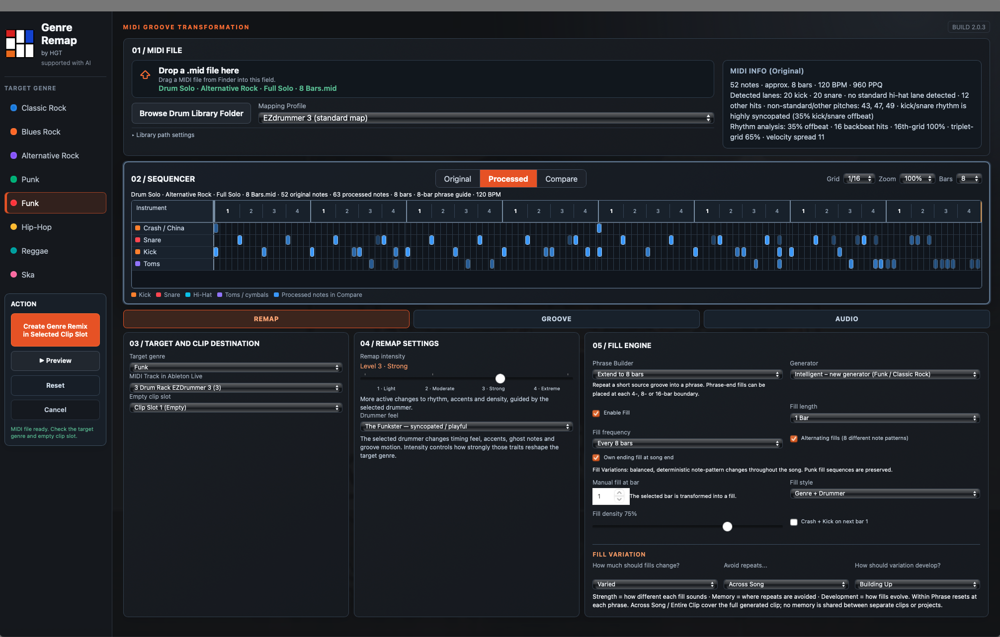

# Genre Remap
### by HGT · Supported with AI

**Transform your grooves. Explore new musical directions.**

Genre Remap is a creative MIDI drum pattern transformation tool for Ableton Live.

It allows musicians and producers to take existing MIDI drum patterns and transform them into different musical genres while exploring new rhythmic possibilities.

Instead of starting from scratch, Genre Remap provides a flexible way to reinterpret existing drum grooves and adapt them to different musical styles.

---

## Key Features

### 1. Genre Selection

Transform MIDI drum patterns into different musical styles.

Supported genres include:

- Classic Rock
- Blues Rock
- Alternative Rock
- Punk
- Funk
- Hip-Hop
- Reggae
- Ska

### 2. MIDI Remapping Engine

Convert existing MIDI drum patterns into genre-specific drum arrangements.

The remapping process adapts the MIDI material to the selected musical style while maintaining its role as the foundation of the groove.

### 3. Groove & Performance Controls

Shape the character of the transformed drum pattern.

- **BPM:** Set the desired tempo.
- **Groove Variation:** Adjust rhythmic variation.
- **Performance Feel:** Influence the playing character.
- **Intensity:** Control the strength of the transformation.
- **Variation Settings:** Explore different interpretations of the original pattern.

### 4. Preview & Audition

Listen to your transformed MIDI patterns before using them in your arrangement.

- Preview audition
- Preview volume control
- Pattern comparison
- Flexible adjustments before final use

### 5. MIDI Workflow

Load existing MIDI drum patterns, select a target genre and explore different transformations.

Use the resulting MIDI material in Ableton Live and continue editing it in your own production workflow.

---

## How to Use

**Step 1 – Load MIDI**

Select an existing MIDI drum pattern.

**Step 2 – Choose a Genre**

Select the musical style you want to explore.

**Step 3 – Adjust Performance Settings**

Set BPM, groove variation, performance feel and transformation intensity.

**Step 4 – Preview**

Audition the result and compare different variations.

**Step 5 – Create Your MIDI Pattern**

Apply the transformation and continue working with the MIDI material in Ableton Live.

---

## Compatibility & Technology

- Developed for Ableton Live.
- Requires Ableton Live 12.4.5 or later.
- Built with the Ableton Live JavaScript SDK.
- Currently testing with Ableton Live 13 Beta.

---

## Downloads & Releases

Available downloads:

- Ready-to-install Ableton Extension (`.ablx`)
- Complete source code (`.zip`)
- Version information
- Release notes

Visit the Releases section for the latest version.

---

## About HGT

**The only good system is a sound system.**

**Music connects people.**

Independent development and creative tools shared with the music community.

Free to use. Community supported.
